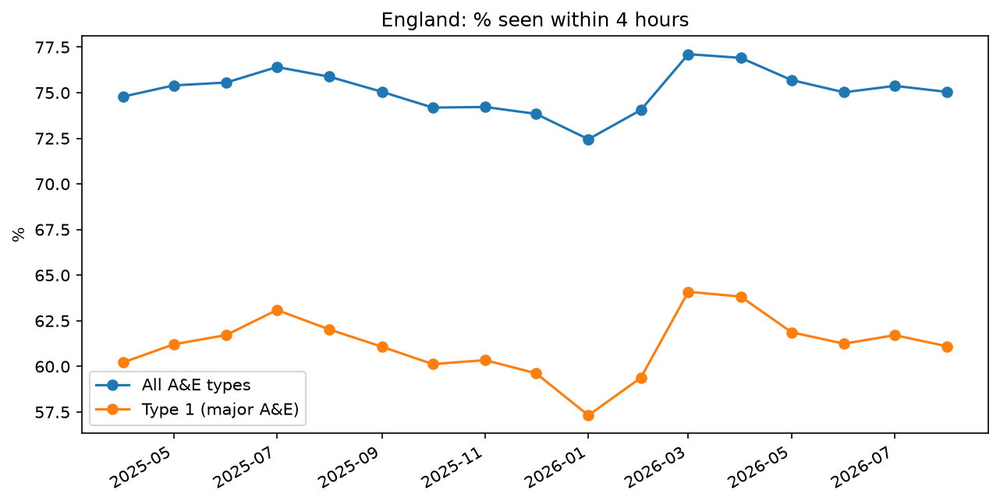
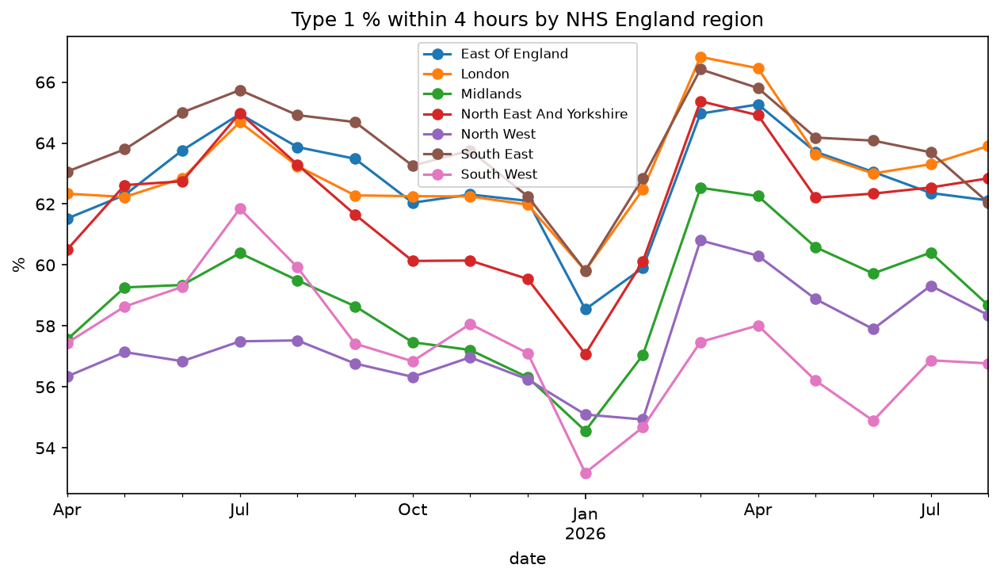
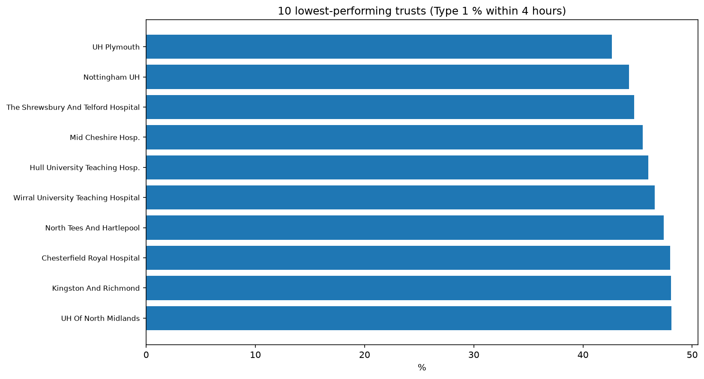

# NHS A&E Performance Analysis

An analysis of how well NHS trusts in England are meeting the 4-hour wait time goal in A&E, using 17 months of official NHS England data from April 2025 to August 2026.

## Summary

- Type 1 (Major A&E) perfomrance ranged from 57.3% in the South West to 63.9% in the South East, leaving a gap of 6.6%
- Type 1 performance fell to 57.3% in January 2026 and grew to 63.9% by march, this is believed to be because of the winter peaking in January, causing A&E to be busier as a result of illness. 6 of 7 regions had their lowest performance in January
- The South West had the biggest decline over the 17 month period of -2.8%

## Charts





## Data

- **Source:** [NHS England, A&E Attendances and Emergency Admissions](https://www.england.nhs.uk/statistics/ae-waiting-times-and-activity/) (monthly, provider level)
- **Coverage:** 17 monthly files from April 2025 to August 2026, 118 trusts with a major A&E department after exclusions

## Method

1. **Combined** 17 monthly CSVs into one dataset and converted the 'Period' column into a proper date
2. **Seperated** the England TOTAL row in each file from individual providers, and kept the totals as a sanity check
3. **Calculated** the % of attendances completed within 4 hours for Type 1 departments
4. **Excluded** providers with no Type 1 attendances and specialist children's and women's trusts
5. **Checked** the England all-types figures (72% to 77% per month) against NHS England's published headline performance

## Finding

**1. Large gap between regions** South West and North West had the lowest Type 1 performances of 57.3% and 57.5% respectively. The South East had the highest performance of 63.9%

**2. Winter effect** The dip in January 2026 affected almost every region. However, since the data only covers one winter, it cannot be concluded if this is a pattern with seasons

**3. The South West is the only decliner** It also did not see any see any spring recovery like the other regions.

**4. Trust-level variation is bigger than regional variation** The ten lowest trusts included Plymouth (42.6%), Nottingham (44.2%) and Shrewsbury and Telford (44.7%)

## How to run

Requires Python 3 with `pandas` and `matplotlib`.

```bash
pip install pandas matplotlib
python clean_data.py     
python build_dataset.py    
python analysis.py        
```

Place the downloaded NHS England CSV files in `data/raw/` first.